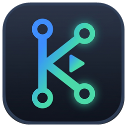

<p align="center">
  
</p>

<h1 align="center">Kafka Local Launcher &amp; Offset Explorer</h1>

<p align="center">
  Windows 환경에서 로컬 Apache Kafka(Zookeeper / KRaft)를 간편하게 실행·관리하고,<br/>
  네이티브 <code>Confluent.Kafka</code> 클라이언트로 고속 토픽·오프셋 탐색까지 지원하는 단일 EXE WPF 데스크톱 툴입니다.
</p>

<p align="center">
  
  
  
  
</p>

---

## 주요 기능

### 1. 로컬 Kafka 런처 (`런처 & 로그` 탭)
- **Zookeeper 모드 / KRaft 모드 (Kafka 3.3+ / 4.x) 전환**
  - Zookeeper 모드: Zookeeper와 Kafka 브로커를 각각 **독립적으로 시작 / 중지**
  - KRaft 모드: `kafka-storage.bat random-uuid` 및 `format --ignore-formatted` 기반 **원클릭 KRaft 스토리지 포맷** 지원
- **프로세스 트리 완전 종료**: `taskkill /PID <pid> /T /F`를 사용해 `.bat`의 하위 `java.exe`까지 좀비 프로세스 없이 정리하며, 창 종료 시 실행 중인 프로세스 처리 옵션을 제공합니다.
- **실행 방식 선택**: 숨김 실행(실시간 로그 스트리밍, 최대 2,000줄 버퍼 제한, 자동 스크롤/지우기) 또는 새 콘솔창(`cmd.exe /k`) 실행 지원.
- **Java 환경 자동 진단 & Portable JDK 지원**:
  - 시작 시 `Portable JDK → 시스템 JAVA_HOME → PATH` 순으로 Java 버전을 자동 감지해 상단 배지에 표시합니다.
  - PC에 Java가 설치되어 있지 않아도 압축만 푼 **Portable JDK(예: Eclipse Temurin)** 폴더를 지정해 로컬 Kafka를 무설치로 실행할 수 있습니다.
- **설정 자동 영속화**: Kafka Root, 실행 모드, `.properties` 경로, Heap(`Xms`/`Xmx`), Cluster ID, Portable JDK 경로, Bootstrap Server를 `%LocalAppData%\KafkaLauncher\settings.xml`에 자동 저장·복원합니다.

### 2. 고속 Offset Explorer (`Offset Explorer` 탭)
`Confluent.Kafka`(`librdkafka`) 네이티브 클라이언트로 브로커와 직접 통신하여 수십 ms 내 응답합니다.
- **클러스터 & 토픽 관리**: Broker 상태 확인, 토픽 목록 조회/필터링, 내부 토픽(`__*`) 숨김 토글, 토픽 생성·삭제
- **메시지 탐색 (Offset Explorer)**:
  - 파티션별(`전체` / 개별 파티션) + 조회 방식(`최신 N건` / `처음부터` / `지정 오프셋` + 이전/다음 구간 이동)
  - 다크 `DataGrid` + 조회 결과 내 키워드 실시간 필터
  - 하단 상세 뷰어: **JSON Pretty-Print / Raw Text / Hex Dump / Headers** 전환 및 원클릭 복사
- **실시간 스트림 (Live Consumer)**: 수동 `Assign`으로 리밸런싱 지연 없이 즉시 실시간 메시지 수신 및 상세 뷰어 확인
- **파티션 워터마크 & 메시지 발행**: 파티션별 `Leader / Replicas / ISR / Earliest / Latest / Messages` 확인(더블클릭으로 탐색 이동), Key / 다중 `Headers` / JSON 정렬 도우미 포함 고속 Producer
- **Consumer Groups & Lag 모니터링**: 그룹별 `Topic / Partition / Current Offset / Log-End Offset / Lag` 테이블 조회

### 3. 단일 EXE 배포 (`Costura.Fody` + 네이티브 DLL 압축 내장)
- 모든 관리 DLL(`Confluent.Kafka`, `Newtonsoft.Json`, `System.*`)은 `Costura.Fody`로 EXE에 임베드됩니다.
- 네이티브 `librdkafka`(`x64`/`x86`) DLL은 빌드 시 ZIP 리소스로 압축 내장되어 최초 실행 시 `%LocalAppData%\KafkaLauncher\native\`에 캐싱 로드됩니다.
- 결과물 `KafkaLauncher.exe` **파일 하나만** 복사해 어떤 Windows PC에서도 바로 실행할 수 있습니다.

---

## 시스템 요구 사항

| 구분 | 요구 사항 | 비고 |
|---|---|---|
| **OS** | Windows 10 / 11 | .NET Framework 4.7.2 기본 내장 |
| **`Offset Explorer` 탭 단독 사용** | **Java 불필요** | 원격/외부 Kafka 브로커 접속은 Java 미설치 PC에서도 즉시 동작 |
| **로컬 Kafka / Zookeeper 실행** | **JDK 11 / 17+** (또는 Portable JDK) | 로컬 Apache Kafka 바이너리 필요 |

---

## 프로젝트 구조

```text
KafkaLauncher/
├── KafkaLauncher.sln
├── README.md
├── AGENTS.md                           # AI 에이전트용 프로젝트 규칙
├── .gitignore
├── .agents/                            # AI 에이전트 커스터마이징 (Skills / Hooks)
│   ├── hooks.json                      # 라이프사이클 훅 설정 (기본 비활성, 선택 활성화)
│   ├── HOOKS.md                        # 훅 사용 및 동작 안내
│   ├── scripts/
│   │   └── check-xaml.ps1              # XAML 구문 검증 훅 스크립트
│   └── skills/
│       ├── build-single-exe/SKILL.md   # 단일 EXE 빌드·검증 워크플로우
│       └── kafka-launcher-dev/SKILL.md # WPF / Kafka 기능 개발 가이드
└── KafkaLauncher/
    ├── App.xaml / App.xaml.cs          # 앱 진입점 및 네이티브 librdkafka 초기화
    ├── MainWindow.xaml / .cs           # 다크 테마 WPF UI (런처 & Offset Explorer)
    ├── KafkaProcessManager.cs          # 로컬 ZK/Kafka/KRaft 프로세스 및 Java 진단 관리
    ├── KafkaExplorerService.cs         # Confluent.Kafka 기반 고속 탐색기/스트리밍/Lag 서비스
    ├── LauncherSettings.cs             # XML 설정 영속화 (%LocalAppData%)
    ├── NativeKafkaLoader.cs            # 내장 librdkafka ZIP 추출 및 로드
    ├── FodyWeavers.xml                 # Costura.Fody 단일 EXE 설정
    ├── KafkaLauncher.csproj            # NuGet PackageReference & 네이티브 압축 빌드 타겟
    └── Resources/
        ├── app.ico                     # 다중 해상도 앱 아이콘 (16~256px)
        └── app_icon.png                # 헤더 로고 PNG
```

---

## 빌드 방법

### Visual Studio 2022
1. `KafkaLauncher.sln` 열기
2. NuGet 패키지 자동 복원 (`Confluent.Kafka`, `Newtonsoft.Json`, `Fody`, `Costura.Fody`)
3. `Release` 또는 `Debug` 구성으로 빌드 → `KafkaLauncher\bin\Release\KafkaLauncher.exe` 생성

### MSBuild CLI (PowerShell)
```powershell
$msbuild = "C:\Program Files\Microsoft Visual Studio\2022\Professional\MSBuild\Current\Bin\MSBuild.exe"
& $msbuild "KafkaLauncher.sln" /t:Restore /v:minimal
& $msbuild "KafkaLauncher.sln" /t:Rebuild /p:Configuration=Release /v:minimal
```

---

## 라이선스

개인 개발 도구 프로젝트입니다. 필요에 맞게 자유롭게 수정·활용하세요.
